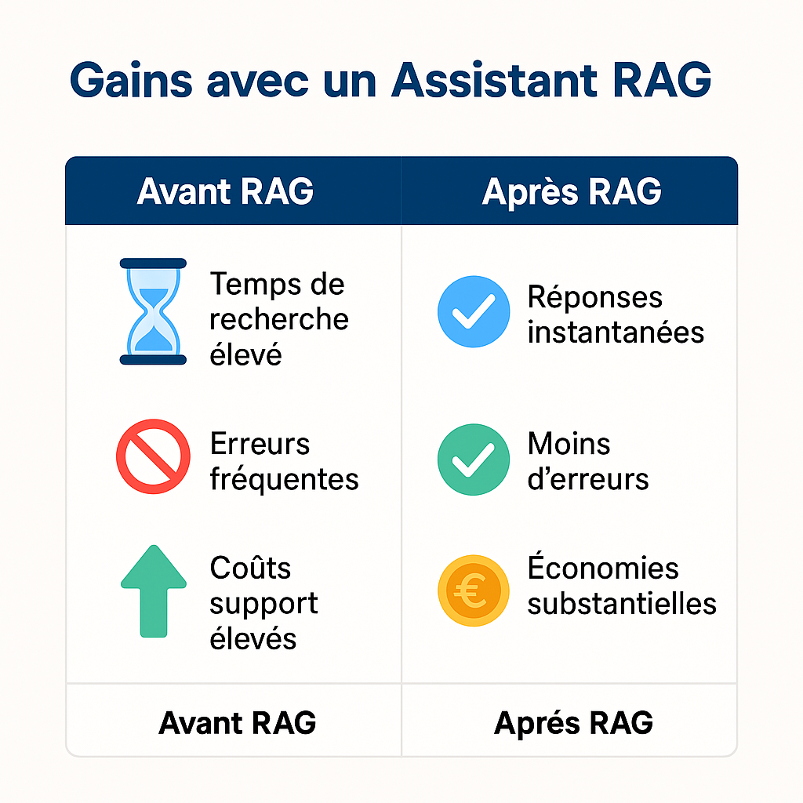

# I) Introduction : qu’est-ce que le RAG (Retrieval-Augmented Generation) ?

La génération augmentée par récupération (RAG) est une approche qui combine les grands modèles de langage (LLM) avec une récupération de données externe en temps réel, afin de produire des réponses plus précises, plus à jour et mieux contextualisées.

Cette méthode est particulièrement pertinente pour traiter des informations propriétaires, fréquemment mises à jour, ou fortement spécialisées par domaine.

## I.1) Qu’est-ce que la génération augmentée par récupération ?

Dans sa forme la plus simple, un système RAG exécute trois étapes :

1. **Récupération (Retrieval)** : la requête utilisateur interroge une base de connaissances externe (vector store, recherche par mots-clés, base SQL, etc.) pour collecter le contexte utile.
2. **Augmentation (Augmentation)** : les données récupérées sont injectées dans le prompt utilisateur avec un format et des consignes adaptés au LLM.
3. **Génération (Generation)** : le prompt enrichi est transmis au LLM, qui produit la réponse finale.


## I.2) Avantages du RAG

Le RAG améliore les systèmes LLM sur plusieurs axes :

* **Connaissances propriétaires** : intégration de contenus internes (documents, e-mails, notes, référentiels métier) absents de l’entraînement initial.
* **Informations à jour** : exploitation d’une base de connaissances régulièrement actualisée.
* **Traçabilité des réponses** : possibilité de citer les sources, facilitant la vérification factuelle.
* **Sécurité et contrôle d’accès (ACL)** : récupération conditionnée selon les droits de l’utilisateur.


## I.3) Composants d’une application RAG

Une application RAG typique inclut :

1. **Pipeline de données** : préparation et indexation de documents, tables et autres sources pour une recherche fiable et rapide.
2. **Chaîne RAG (retrieval, augmentation, generation)** :
   * compréhension de la question,
   * récupération du contexte pertinent,
   * enrichissement du prompt,
   * génération de la réponse.
3. **Évaluation et monitoring** : mesure de la qualité, du coût et de la latence.
4. **Gouvernance et LLMOps** : gestion du cycle de vie, lineage des données et politiques d’accès.

## I.4) Types de données RAG : structurées et non structurées

Une architecture RAG peut exploiter des données non structurées comme structurées, selon le cas d’usage.

**Données non structurées** :

* PDF
* Documents Google/Office
* Wikis
* Images
* Vidéos

**Données structurées** :

* Enregistrements clients dans un système BI / Data Warehouse
* Données transactionnelles en base SQL
* Données issues d’APIs applicatives (ex. SAP, Salesforce, etc.)



# II) Démo projet avec le framework LlamaIndex

**Objectif de la démo :** comprendre le fonctionnement de LlamaIndex et construire un assistant RAG simple appliqué à une documentation dans le domaine de la robotique.

- Utiliser `build_venv.ps1` (Windows/PowerShell) ou `build_venv.sh` (Linux/Shell) pour créer et configurer l’environnement virtuel `.venv`.
- Activer l’environnement virtuel puis sélectionner l’interpréteur Python dans le notebook Jupyter (`*.ipynb`) pour exécuter les tests de la démo.

## II.1) LlamaIndex : créer un RAG en quelques lignes

LlamaIndex est un **framework Python open source spécialisé dans la création de systèmes RAG et d’applications basées sur les LLM**.

Sa promesse : construire un pipeline RAG opérationnel en peu de code, tout en conservant la flexibilité nécessaire pour des cas d’usage avancés.

Son positionnement est clair : **connecter les données métier à des modèles de langage**.

Source : [Documentation développeur](https://developers.llamaindex.ai/llamaparse/)

Construire un système RAG peut rapidement devenir complexe :

- ingestion des documents,
- découpage en chunks,
- génération d’embeddings,
- stockage vectoriel,
- orchestration retrieval + generation.

Chaque étape implique des choix techniques et de l’intégration.  
LlamaIndex réduit cette charge pour permettre aux équipes de se concentrer sur la valeur métier.

Dans ce repository, l’objectif est d’explorer LlamaIndex, ses composants clés, et de mettre en place un RAG fonctionnel de bout en bout.

## II.2) LlamaIndex : un framework nativement orienté RAG

LlamaIndex part d’un constat simple : les LLM sont puissants, mais limités par une connaissance figée à la date d’entraînement.  
Pour les rendre réellement utiles sur des données privées et métier, il faut un système de récupération robuste.

Le framework s’appuie sur **cinq étapes fondamentales** :

- **Loading** : ingestion des données (fichiers, bases, APIs),
- **Indexing** : structuration pour la recherche (chunking, embeddings, stockage),
- **Storing** : persistance des index pour éviter les recalculs,
- **Querying** : récupération du contexte et génération de réponse,
- **Evaluation** : mesure et amélioration continue de la qualité.

Cette organisation reflète la philosophie de LlamaIndex : fournir des abstractions haut niveau, tout en laissant la main sur les réglages fins si nécessaire.

| **Composant**         | **Rôle**                                    | **Exemples**                                  |
| --------------------- | ------------------------------------------- | --------------------------------------------- |
| **Data Connectors**   | Charger des données depuis plusieurs sources | SimpleDirectoryReader, PDFReader, NotionReader |
| **Documents & Nodes** | Représenter et découper les données          | Document, TextNode, ImageNode                 |
| **Embeddings**        | Vectoriser le texte pour la recherche        | OpenAIEmbedding, HuggingFaceEmbedding         |
| **Index**             | Structurer les données pour la requête       | VectorStoreIndex, SummaryIndex, KnowledgeGraphIndex |
| **Retrievers**        | Récupérer les informations pertinentes       | VectorIndexRetriever, BM25Retriever           |
| **Query Engine**      | Orchestrer récupération et génération        | RetrieverQueryEngine                          |

La force de LlamaIndex repose aussi sur ses connecteurs : fichiers locaux, bases de données, services cloud et APIs web.

## II.3) LlamaIndex vs LangChain : quelles différences ?

La comparaison avec [LangChain](https://blent.ai/blog/a/langchain-framework-llm) est naturelle : les deux frameworks traitent des problématiques proches, mais avec un positionnement différent.

- **LangChain** suit une approche généraliste : très flexible pour construire des applications LLM variées, mais plus exigeante en assemblage pour un RAG.
- **LlamaIndex** est spécialisé dans la connexion données ↔ LLM : expérience plus directe pour les projets RAG, avec moins de code d’orchestration.

| Critère                     | LlamaIndex                        | LangChain                                  |
| -------------------------- | ---------------------------------- | ------------------------------------------ |
| Focus principal            | RAG et indexation de données       | Applications LLM généralistes              |
| Courbe d’apprentissage     | Rapide pour le RAG                 | Plus raide, plus de concepts               |
| Lignes de code (RAG basique) | ~5 lignes                        | ~15-20 lignes                              |
| Connecteurs de données     | Très riche (150+)                  | Moins exhaustif                            |
| Agents et workflows        | Supportés mais secondaires         | Point fort historique                      |
| Écosystème                 | LlamaHub pour les extensions       | LangChain Hub, nombreuses intégrations     |

En pratique, ces frameworks sont complémentaires : LlamaIndex peut gérer indexation/récupération, puis LangChain orchestrer des workflows plus complexes.

## II.4) Informations complémentaires

### a) Installation des skills et des plugins

Un **skill** est une capacité autonome chargée à la demande par un agent.  
LlamaParse propose notamment :

* **`llamaparse`** — parsing de documents non structurés et extraction de texte via [Parse](https://developers.llamaindex.ai/llamaparse/parse/getting_started/).  
  Gère PDF, présentations, documents Word, tableurs et images, y compris des documents complexes (tableaux, graphiques).  
  Pré-requis : `LLAMA_CLOUD_API_KEY` (voir le [guide API Key](https://developers.llamaindex.ai/llamaparse/general/api_key/)), Node 18+, npm, et éventuellement `@llamaindex/llama-cloud`.
* **`liteparse`** — parsing local-first rapide, conversion de documents et extraction spatiale de texte.  
  Optimisé pour les PDF et documents textuels denses ; fonctionne localement sans clé API.  
  Pré-requis : Node 18+, npm, package global `@llamaindex/liteparse` ; support Office via LibreOffice, support image via ImageMagick.

Installer les deux skills depuis le [repository skills](https://github.com/run-llama/llamaparse-agent-skills) avec la CLI [`skills`](https://www.npmjs.com/package/skills) :

```shell
npx skills add run-llama/llamaparse-agent-skills
```

Installer un skill unique :

```shell
npx skills add run-llama/llamaparse-agent-skills --skill llamaparse
```

Alternative : téléchargement du fichier `.zip` depuis les Releases GitHub du repository.

Pour les plugins, consulter la [documentation officielle](https://developers.llamaindex.ai/llamaparse/for-agents/skills/#plugins).

### b) Installation MCP

* [LlamaParse MCP](https://developers.llamaindex.ai/llamaparse/for-agents/mcp/) — connecter n’importe quel client compatible MCP à la plateforme, sans installer de skill.
* [LlamaParse Platform n8n Node](https://developers.llamaindex.ai/llamaparse/for-agents/integrations/n8n/) — créer des pipelines documentaires sans code.
