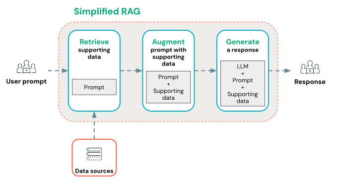
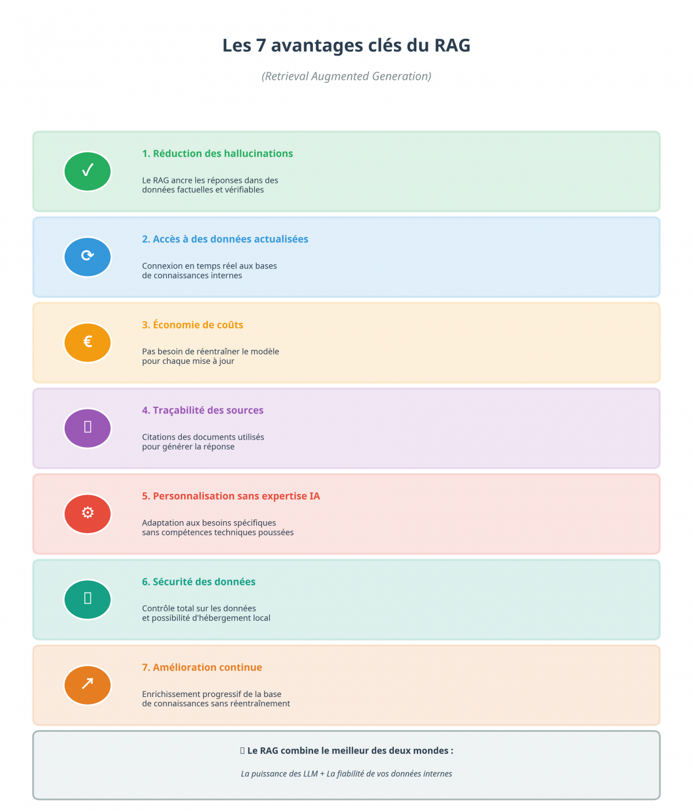

# I) Introduction: C'est quoi le RAG (Retrieval Augmented Generation)

La génération augmentée par récupération (RAG) est une technique puissante qui combine des grands modèles linguistiques (LLM) avec la récupération de données en temps réel pour générer des réponses plus précises, à jour et contextuellement pertinentes.

Cette approche est particulièrement précieuse pour répondre aux questions concernant des information propriétaires, fréquemment modifiées ou spécifiques à un domaine.

## I.1) Qu’est-ce que la génération augmentée de récupération ?

Dans sa forme la plus simple, un agent RAG effectue les opérations suivantes :

1. **Récupération** : la **requête de l'utilisateur est utilisée pour interroger une base de connaissances externe, telle qu'un magasin de vecteurs, une recherche par mots-clés ou une base de données SQL.** L'objectif est d'obtenir des données complémentaires pour la réponse du LLM.
2. **Augmentation** : Les données d’appui sont combinées à la requête de l’utilisateur, souvent à l’aide d’un Template comportant un formatage et des instructions supplémentaires pour le LLM, afin de créer un prompt.
3. **Génération** : l'invite est transmise au LLM pour générer une réponse à la demande de l'utilisateur.



## I.2) Avantages du RAG

La RAG améliore les LLM des manières suivantes :

* **Connaissances propriétaires :** La RAG peut inclure des informations propriétaires non utilisées initialement pour entraîner le LLM, telles que des mémos, des e-mails et des documents pour répondre à des questions spécifiques au domaine.
* **Informations à jour :** une application RAG peut fournir au LLM des informations provenant d'une base de connaissances mise à jour.
* ****Citer les sources** :** RAG permet aux LLM de citer des sources spécifiques, permettant aux utilisateurs de vérifier l'exactitude factuelle des réponses.
* **Sécurité des données et listes de contrôle d'accès (ACL) :** L'étape de récupération peut être conçue pour récupérer sélectivement des informations personnelles ou propriétaires en fonction des informations d'identification de l'utilisateur.



## I.3) Composants RAG

Une application RAG typique implique plusieurs étapes :

1. **Pipeline de données** : Prétraiter et indexer des documents, des tables ou d'autres données pour une récupération rapide et précise.
2. **chaîne RAG (retrieval, augmentation, generation)** : appelez une série (ou chaîne) d'étapes pour :
   * Comprendre la question de l'utilisateur.
   * Récupérer les données de support.
   * Augmentez le prompt avec des données d’assistance.
   * Générez une réponse d'un LLM en utilisant l'invite augmentée.
3. ****Évaluation et monitoring**** : évaluez l’application RAG afin de déterminer sa qualité, son coût et sa latence pour vous assurer qu’elle répond à vos exigences métier.
4. **Gouvernance et LLMOps** : Suivez et gérez le cycle de vie de chaque composant, y compris le data lineage et les contrôles d'accès.

## I.4) Types de données RAG : structurées et non structurées

L'architecture RAG peut fonctionner avec des données de support non structurées ou structurées. Les données que vous utilisez avec la RAG dépendent de votre cas d'utilisation.

**Données non structurées :** Données sans structure ni organisation spécifique.

* PDF
* Documents Google/Office
* Wikis
* Images
* VIDÉOS

**Données structurées :** Données tabulaires organisées en lignes et colonnes avec un schéma spécifique, telles que des tables dans une base de données.

* Enregistrements client dans un système BI ou Data Warehouse
* Données transactionnelles d'une base de données SQL
* Données provenant des APIs d'applications (par ex., SAP, Salesforce, etc.)


# II) Projet Demo avec le framework LlamaIndex:

*Objectif de la demo:* **Comprendre le fontionnement de LlamaIndex et pouvoir créer un simple assistant RAG pour une documentation dans le domaine de la Robotique**

- Utiliser les fichiers build_venv.ps1 (Windows/Powershell) or build_venv.sh (Linux/Shell) pour installer et configurer votre environnement virtuel (.venv) de travail,
- Activer environnement virtuel (.venv) et selectionner l'interpreteur python dans le jupyter notebook (*.ipynb) pour tester ce framework,

## II.1) LlamaIndex : créer son RAG en quelques lignes de code

LlamaIndex est un **framework Python open source spécialisé dans la création de systèmes RAG et d'applications basées sur les LLM.**
**Sa promesse** : permettre de construire un pipeline RAG fonctionnel en quelques lignes de code, tout en offrant la flexibilité nécessaire pour les cas d'usage avancés.
Là où d'autres frameworks adoptent une approche généraliste, LlamaIndex a fait le choix de l'excellence sur un périmètre précis :
==> **connecter vos données à des modèles de langage.**

Source: [Developer docs](https://developers.llamaindex.ai/llamaparse/)

La construction d'un système RAG (Retrieval Augmented Generation) peut rapidement devenir un projet complexe :

- gérer l'ingestion de documents,
- leur découpage en chunks,
- la création d'embeddings,
- le stockage vectoriel,
- puis orchestrer la récupération et la génération...

Chaque étape nécessite des choix techniques et du code d'intégration.
Pour les équipes qui souhaitent se concentrer sur la valeur métier plutôt que sur la plomberie technique, LlamaIndex offre une alternative séduisante.

Dans ce repo, nous allons explorer ce qu'est LlamaIndex, comprendre son architecture et ses composants clés, et voir concrètement comment construire un RAG opérationnel en quelques minutes.

## II.2) LlamaIndex : un framework pensé pour le RAG

LlamaIndex est né d'un constat simple :

- *les LLM sont puissants mais limités par leur connaissance figée au moment de leur entraînement.*
  Pour les rendre utiles sur des données propriétaires - documentation interne, bases de connaissances, corpus métier - il faut les augmenter avec un système de récupération.
  ==> **C'est précisément ce que LlamaIndex facilite.**

Le framework s'articule autour de **cinq étapes fondamentales** qui correspondent au cycle de vie d'un système RAG :

- **Loading :** ingestion des données depuis diverses sources (fichiers, bases de données, APIs),
- **Indexing :** structuration des données pour une recherche efficace (chunking, embeddings, stockage),
- **Storing :** persistance des index pour éviter de recalculer à chaque utilisation,
- **Querying :** récupération des informations pertinentes et génération de réponses,
- **Evaluation :** mesure de la qualité du système pour l'améliorer itérativement.

Cette organisation reflète la philosophie de LlamaIndex :
==> **fournir des abstractions de haut niveau pour chaque étape tout en permettant de descendre dans les détails quand nécessaire.
Un développeur peut construire un RAG fonctionnel sans comprendre les subtilités du chunking, puis affiner progressivement chaque composant à mesure que ses besoins se précisent.

| **Composant**         | **Rôle**                              | **Exemples**                                  |
| --------------------------- | -------------------------------------------- | --------------------------------------------------- |
| **Data Connectors**   | Charger des données depuis diverses sources | SimpleDirectoryReader, PDFReader, NotionReader      |
| **Documents & Nodes** | Représenter et découper les données       | Document, TextNode, ImageNode                       |
| **Embeddings**        | Vectoriser le texte pour la recherche        | OpenAIEmbedding, HuggingFaceEmbedding               |
| **Index**             | Structurer les données pour la requête     | VectorStoreIndex, SummaryIndex, KnowledgeGraphIndex |
| **Retrievers**        | Récupérer les informations pertinentes     | VectorIndexRetriever, BM25Retriever                 |
| **Query Engine**      | Orchestrer récupération et génération    | RetrieverQueryEngine                                |

La force de LlamaIndex réside dans ses **connecteurs de données** qui couvrent un spectre impressionnant de sources :

- fichiers locaux (PDF, Word, HTML, Markdown),
- bases de données (PostgreSQL, MongoDB),
- services cloud (Google Drive, Notion, Slack),
- et même des APIs web.

Cette richesse permet d'intégrer rapidement des données existantes sans développement spécifique.

## **II.3) LlamaIndex vs LangChain : quelles différences ?**

La comparaison avec [LangChain](https://blent.ai/blog/a/langchain-framework-llm) est inévitable car les deux frameworks adressent des problématiques similaires. Comprendre leurs différences permet de choisir l'outil le plus adapté à chaque projet.

- **LangChain** adopte une approche **généraliste** : c'est une boîte à outils complète pour construire des applications LLM de toute nature. Son abstraction centrale, la "chain", permet de composer des séquences d'opérations arbitraires. Cette flexibilité a un coût : la courbe d'apprentissage est plus raide, et construire un RAG nécessite d'assembler manuellement plusieurs composants.
- **LlamaIndex** est **spécialisé** dans la connexion de données aux LLM. Son abstraction centrale, l'index, est optimisée pour ce cas d'usage précis. Cette spécialisation se traduit par une expérience plus fluide pour les projets RAG : moins de code boilerplate, des défauts sensés, et une documentation focalisée.

| Critère                     | LlamaIndex                    | LangChain                               |
| ---------------------------- | ----------------------------- | --------------------------------------- |
| Focus principal              | RAG et indexation de données | Applications LLM génériques           |
| Courbe d'apprentissage       | Douce pour le RAG             | Plus raide, plus de concepts            |
| Lignes de code (RAG basique) | ~5 lignes                     | ~15-20 lignes                           |
| Connecteurs de données      | Très riche (150+)            | Moins exhaustif                         |
| Agents et workflows          | Supportés mais secondaires   | Point fort historique                   |
| Écosystème                 | LlamaHub pour les extensions  | LangChain Hub, intégrations nombreuses |

En pratique, les deux frameworks ne sont pas mutuellement exclusifs. De nombreux projets utilisent LlamaIndex pour la partie indexation et récupération, puis LangChain pour l'orchestration de workflows plus complexes. LlamaIndex propose d'ailleurs des intégrations natives avec LangChain pour faciliter cette complémentarité.

Le choix dépend de votre cas d'usage :

* **Projet centré sur le RAG** avec des besoins d'indexation complexes → LlamaIndex
* **Application LLM diverse** avec agents, chaînes de prompts, intégrations multiples → LangChain
* **Prototype rapide** pour valider une approche RAG → LlamaIndex (moins de friction initiale)

## II.4) Infos supplémentaires:

### a) Installing skills and plugins:

A skill is a self-contained capability an agent loads on demand. LlamaParse provides two:

* **`llamaparse`** — unstructured document parsing and text extraction powered by [Parse](https://developers.llamaindex.ai/llamaparse/parse/getting_started/). Handles PDFs, presentations, Word documents, spreadsheets, and images, and is built for complex documents with charts and tables that need sophisticated extraction. Requires a `LLAMA_CLOUD_API_KEY` (see the [API Key guide](https://developers.llamaindex.ai/llamaparse/general/api_key/)), Node 18+, and npm; it can use the `@llamaindex/llama-cloud` package.
* **`liteparse`** — local-first, fast document parsing, conversion, and spatial text extraction. Prioritizes speed for PDFs and text-dense documents with tables and images, and runs entirely locally with no API key. Requires Node 18+, npm, and the globally installed `@llamaindex/liteparse` package; Office support additionally needs LibreOffice, and image support needs ImageMagick.

Install both skills from the [skills repository](https://github.com/run-llama/llamaparse-agent-skills) with the [`skills` CLI](https://www.npmjs.com/package/skills):

```Shell
npx skills add run-llama/llamaparse-agent-skills
```

To install a single skill, pass `--skill`:

```Shell
npx skills add run-llama/llamaparse-agent-skills --skill llamaparse
```

Alternatively, download the `.zip` from the repository’s GitHub Releases.

for Plugins, see [Documentation](https://developers.llamaindex.ai/llamaparse/for-agents/skills/#plugins)

### b) Installing MCP:

* [LlamaParse MCP](https://developers.llamaindex.ai/llamaparse/for-agents/mcp/) — connect any MCP-compatible client to the platform without installing a skill.
* [LlamaParse Platform n8n Node](https://developers.llamaindex.ai/llamaparse/for-agents/integrations/n8n/) — build document pipelines without code.
